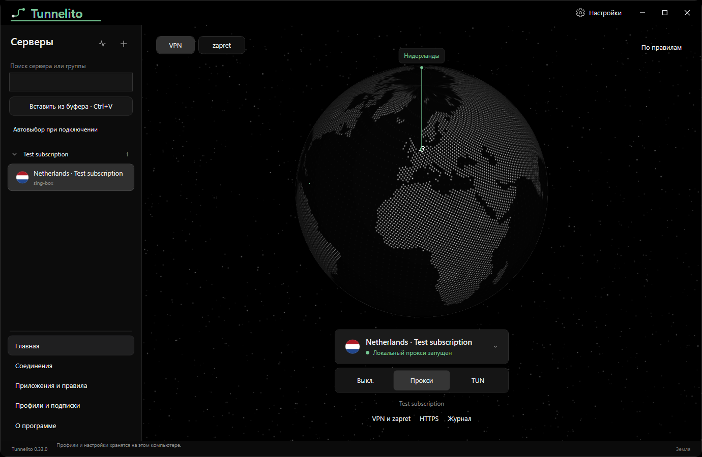
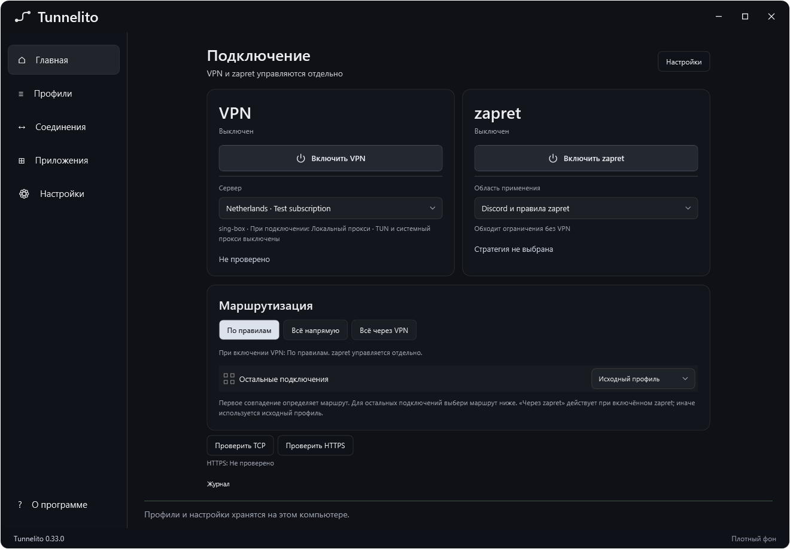
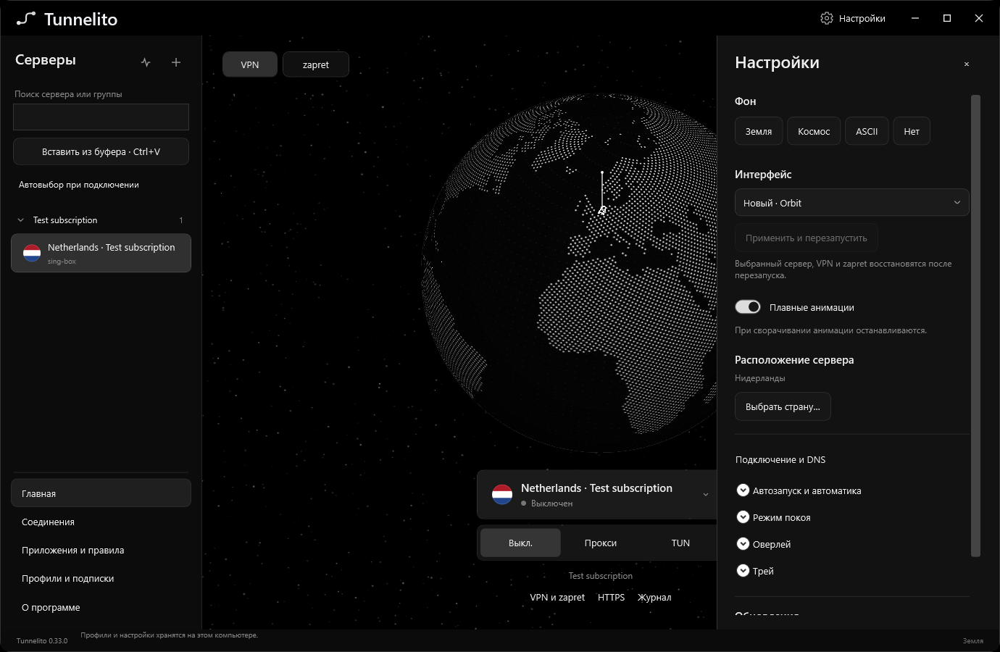
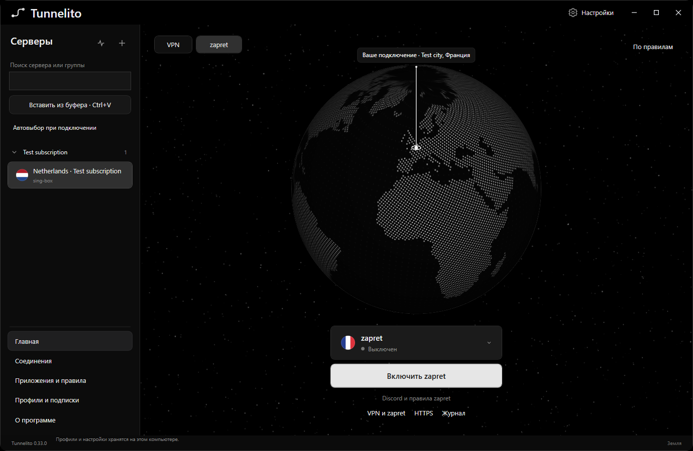

# Tunnelito

VPN-приложение для Windows с отдельным управлением zapret. C# / .NET 9 / WPF. Прежнее название — RelayDesk.

[Скачать установщик](https://github.com/rapichmoney/Tunnelito/releases/latest) · [Сообщить об ошибке](https://github.com/rapichmoney/Tunnelito/issues)



## Подключение

Выбери сервер слева, затем режим «Прокси» или «TUN». zapret включается отдельно. Полоса под названием заполняется до конца после запуска ядра, название набирает зелёный цвет. Кнопка HTTPS отдельно проверяет доступ в интернет. На Земле выделяется контур страны выбранного сервера; страну можно указать вручную.

В режиме zapret на карте показана точка исходного подключения. Запрос IP-геолокации идёт через обычный IPv4-интерфейс без системного прокси и без отключения VPN. Сохраняются город, страна и координаты из ответа провайдера; IP не сохраняется. Результат кэшируется на час. Нажатие на карточку zapret или «Обновить положение» повторяет запрос. Данные IP провайдера могут отличаться от фактического положения устройства.

Поддерживаются sing-box, Xray, mihomo и Flowseal/zapret. Все четыре ядра входят в установщик. TUN доступен для sing-box, Xray работает через системный прокси, mihomo запускает исходную конфигурацию.

## Профили и правила

- VLESS, VMess, Trojan, Shadowsocks, JSON/YAML, HTTPS-подписки и `happ://add/`.
- Вставка из буфера, перетаскивание, QR с экрана. Перед импортом — предпросмотр и выбор серверов.
- Группы подписок и отдельные конфигурации; TCP-задержка по кнопке, отдельная проверка HTTPS.
- Правила приложений, доменов, суффиксов и IP общие для профилей и групп.
- В «Соединениях» щелчок по заголовку сортирует, правая кнопка открывает фильтр. Ctrl + щелчок и Ctrl+A выделяют несколько строк для настройки.
- Пресеты: по правилам, всё напрямую, всё через VPN. Маршрут для остальных подключений настраивается отдельно.

Правила EXE требуют sing-box с TUN. В текущей версии такие правила блокируют отключение TUN: эта логика в ребрендинге не менялась. Системный прокси обслуживает приложения, которые его используют, и не заменяет перехват всего трафика.

## Интерфейс

Orbit и классический интерфейс переключаются через «Настройки → Интерфейс → Применить и перезапустить». Выбранный сервер, VPN/zapret и черновики восстанавливаются. Фоны: Земля, космос, ASCII-акулы или чёрный.

Название при первом обновлении переходит из RelayDesk в Tunnelito за 850 мс. Повторный запуск — появление за 220 мс. Уменьшение движения Windows и настройка анимации учитываются. Знак маршрута прорисовывается один раз при переключении подключения.


<details><summary>Классический интерфейс</summary>



</details>

<details><summary>Настройки</summary>



</details>

Снимки и запись сделаны с тестовой подпиской. На главном снимке работает локальное тестовое ядро без TUN и системного прокси. Исходная точка на примере ниже — тестовый город. Личные ключи, IP и адреса подписок не публикуются.

<details><summary>Исходное подключение в режиме zapret</summary>



</details>

## Установка и обновление

Скачай `Tunnelito-Setup-<версия>-x64.exe` и файл `.sha256` из Releases. Поддерживаются Windows 10 1809 и Windows 11, x64. Среда .NET и ядра включены. Установщик запросит права администратора.

Обновление поверх RelayDesk сохраняет прежнюю папку установки и данные в `%LOCALAPPDATA%\RelayDesk`. Идентификатор установки, mutex, задачи Windows и протоколы QR сохранены. Основной запуск — `Tunnelito.exe`; `RelayDesk.exe` оставлен для совместимости со старыми ярлыками.

Работающая программа перед заменой файлов сохраняет компоненты подключения, выбранный сервер и черновики, закрывает собственные ядра и восстанавливает состояние после установки. При удалении данные пользователя остаются на компьютере.

**Переход с RelayDesk 0.31.0 и более ранних версий:** установи Tunnelito вручную. Старый обновлятор отклоняет адреса после переименования GitHub-аккаунта. Tunnelito использует `rapichmoney/Tunnelito` и проверяет размер и SHA-256 обновления. Источники ядер остаются прежними. [Совместимость и проверенные сценарии](docs/REBRANDING.md).

## Дополнительно

Есть трей, автозапуск Windows с независимым включением VPN/zapret, журнал, режим покоя и перемещаемый оверлей скорости VPN. Параметры оверлея: угол, положение, непрозрачность, размер текста и ASCII-фон.

На части голосовых серверов Discord прямое подключение с zapret может зависать на DTLS. Проверка API или UDP discovery не доказывает работоспособность голоса. Для таких узлов можно использовать VPN.

## Сборка

Нужны .NET SDK 9 и Inno Setup 6. Проект и пространства имён сохраняют техническое имя RelayDesk.

```powershell
dotnet build .\RelayDesk\RelayDesk.csproj -c Release
powershell -NoProfile -ExecutionPolicy Bypass -File .\RelayDesk\installer\Build-Installer.ps1 -Repository rapichmoney/Tunnelito
```

Установщик появится в `RelayDesk/installer/output`. `cores.lock.json` закрепляет версии и SHA-256 ядер. Пользовательские данные в пакет не входят. Публикация тега `v<версия>` запускает сборку GitHub Actions.

Земля использует данные Natural Earth; сведения в [Orbit/NOTICE.md](RelayDesk/Orbit/NOTICE.md). Лицензии библиотек и ядер включены в пакет.
